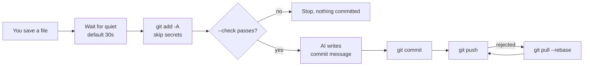

<div align="center">

# 🤖 git-autopilot

**Stop writing commit messages. Just code.**

A local AI agent that watches your project and automatically runs
`git add` → AI-written commit message → `git commit` → `git push`.

[](https://github.com/guptamayank9/git-autopilot/actions/workflows/ci.yml)
[](LICENSE)
[](https://nodejs.org)
<!-- After publishing to npm, add: [](https://www.npmjs.com/package/git-autopilot-ai) -->

<!-- Add your demo GIF here (15-20 seconds): -->
<!--  -->

</div>

---

## Why

Writing a good commit message after every small change breaks your flow, so most of us end up with
history full of `update`, `fix`, `changes`, or forget to push at all.

git-autopilot sits in the background. When you stop saving for a while, it looks at what changed,
asks an AI to write a clean [Conventional Commit](https://www.conventionalcommits.org/) message,
commits, and pushes.

```
[12:21:08 pm] Committing 1 file(s): docs(navbar): add header comment
[12:21:11 pm] ✅ Pushed.
```

- 🆓 **Free to run.** Works with Gemini's free tier, fully offline with Ollama, or with no AI at all.
- 🛡️ **Safe by default.** Never commits `.env` files or private keys. Optional build check before every push.
- 🧠 **Smart messages.** `feat(navbar): add search bar` instead of `update`.
- 🔁 **Handles real life.** If the remote has new commits, it rebases and retries automatically.
- 📦 **Tiny.** One dependency (`chokidar`), no config file needed.

## How it works



## Quick start

Open a terminal **inside your project folder** and run one command:

```bash
cd your-project
npx git-autopilot-ai
```

That's it. The first time, it asks you to paste a free Gemini key
(get one in 20 seconds at [aistudio.google.com/apikey](https://aistudio.google.com/apikey)),
saves it, and never asks again. Then it starts watching your project.
Press `Ctrl+C` to stop.

Want to look before it touches anything? Add `--dry-run`. It only prints the commit message:

```bash
npx git-autopilot-ai --once --dry-run
```

> **Requirements:** Node.js 18+, and a project that is already a git repository with a remote
> (`git remote -v`). Make sure a normal `git push` works once before using the agent.
> Pressing Enter at the key prompt skips the AI and uses simple file-name messages.

### Other ways to install

```bash
# Straight from GitHub (no npm publish needed)
cd your-project
npx github:guptamayank9/git-autopilot

# Install globally, then run from inside any project
npm install -g git-autopilot-ai
cd my-project
git-autopilot
```

## Recommended setup

Because it commits automatically, work-in-progress code can reach your branch. This setup keeps you safe:

```bash
git-autopilot --branch auto-save --check "npm run build"
```

- `--branch auto-save` commits to a separate branch, so `main` stays clean. Merge it when you are happy.
- `--check "npm run build"` runs your build first. If it fails, nothing is committed or pushed.

## Options

| Option | Description |
| --- | --- |
| `[path]` | Project folder (default: current folder) |
| `--once` | Commit and push once, then exit. Exit code is `1` if it failed |
| `--dry-run` | Show the commit message, but do not commit or push |
| `--delay <seconds>` | Wait this long after your last save (default: `30`) |
| `--branch <name>` | Work on this branch, creating it if needed. Your working folder switches to it |
| `--check "<cmd>"` | Run a command first (e.g. `"npm test"`). If it fails, nothing is pushed |
| `--provider <name>` | `gemini`, `ollama`, `openrouter` or `none` (default: auto-detect) |
| `--model <name>` | Use a different AI model |
| `--files-only` | Send only file names to the AI, never your code |
| `--setup` | Enter or change your Gemini key (also runs automatically on first use) |
| `-h`, `--help` / `-v`, `--version` | Help and version |

## AI providers

| Provider | Cost | Setup |
| --- | --- | --- |
| **Gemini** | Free tier | Set `GEMINI_API_KEY`. Default model: `gemini-3.8-flash` |
| **Ollama** | Free, runs offline | Install [Ollama](https://ollama.com), run `ollama pull llama3.2`, then use `--provider ollama` |
| **OpenRouter** | Free `:free` models | Set `OPENROUTER_API_KEY` |
| **none** | Free | No AI. Message is built from file names, e.g. `chore: update App.jsx` |

The provider is auto-detected: `GEMINI_API_KEY` set → Gemini, else `OPENROUTER_API_KEY` set → OpenRouter, else no AI.
If the AI request fails (no internet, wrong model name, quota), git-autopilot falls back to the file-name
message instead of stopping.

## Configuration

Settings are read in this order (first one found wins):

1. Real environment variables
2. `.env` in the project folder
3. `~/.git-autopilot.env` (applies to every project)

Only these keys are ever read, so your project's other secrets are never touched:

| Key | Purpose |
| --- | --- |
| `GEMINI_API_KEY` | Gemini key |
| `OPENROUTER_API_KEY` | OpenRouter key |
| `OLLAMA_URL` | Ollama address (default `http://localhost:11434`) |
| `AUTOPILOT_PROVIDER` | Same as `--provider` |
| `AUTOPILOT_MODEL` | Same as `--model` |

## Safety and privacy

**What it does to protect you**

- Never commits `.env`, `.env.*` (except `.env.example`), `*.pem`, `*.key`, `*.p12`, `*.pfx`, `id_rsa*`, `id_ed25519*`, even if they are missing from your `.gitignore`. It skips them and warns you.
- Respects your `.gitignore`.
- Does not watch `node_modules`, `dist`, `build`, `.next` or `coverage`.
- Skips a round if a merge or rebase is already in progress.
- On a rebase conflict it runs `git rebase --abort` and asks you to fix it manually, so your files are never left half-merged.

**What you should know**

- It stages **everything** in your working tree (`git add -A`) and does **not** ask for review. Use `--branch` and `--check` if that worries you.
- **Your code diff is sent to the AI provider you choose** (lock files excluded, cut off at 20,000 characters). This also happens with `--dry-run`. For private code, use `--provider ollama` (nothing leaves your machine) or `--files-only` (only file names are sent).
- Don't point it at a shared team branch. It is built for solo and personal projects.

## FAQ

**Will it commit on every save?**
No. It waits until you have stopped saving for `--delay` seconds (30 by default), then makes one commit.

**Can I see what it will do first?**
Yes. Use `--dry-run`. Combine with `--once` to run a single check and exit.

**Does it work without internet or without an API key?**
Without a key it uses file-name messages. With Ollama the AI runs fully offline. Pushing to GitHub always needs internet.

**Does it work with GitLab or Bitbucket?**
It runs normal `git push`, so any remote that works from your terminal works here. Log messages say "Pushed", not "pushed to GitHub".

**How do I stop it?**
Press `Ctrl+C` in the terminal where it is running.

## Troubleshooting

| Problem | Fix |
| --- | --- |
| `is not a git repository` | Run it on your project folder, not on the git-autopilot folder |
| Path with spaces on Windows | Wrap the path in quotes: `"C:\Users\me\My Project"` |
| `AI request failed (404 ...)` | The model name is outdated. Pass a current one with `--model` |
| `GEMINI_API_KEY is missing` | Run `npx git-autopilot-ai --setup` |
| Push is denied or asks for login | Run `git push` manually once, sign in, then retry |
| `Rebase conflict` | Run `git pull`, resolve the conflicts, then save a file again |
| Vercel/Netlify deployment blocked | Your commit email may not match your GitHub account. Check `git config user.email` |

## Development

```bash
git clone https://github.com/guptamayank9/git-autopilot
cd git-autopilot
npm install
npm test                          # runs the test suite
node bin/git-autopilot.js --help
```

The tests create temporary git repositories with a local fake remote, so they never touch your real projects.

```
bin/git-autopilot.js   CLI: argument parsing and watch loop
lib/runner.js          add → check → commit → push (with rebase retry)
lib/ai.js              Gemini / OpenRouter / Ollama + no-AI fallback
lib/config.js          safe .env loading
test/smoke.js          end-to-end tests
```

## Contributing

Issues and pull requests are welcome. Ideas that would make this better:

- A config file (`.git-autopilot.json`) for per-project settings
- More AI providers
- Custom commit message styles (e.g. emoji, ticket numbers)
- Desktop notification after each push

Please run `npm test` before opening a pull request.

## License

[MIT](LICENSE) © Mayank Kumar Gupta
